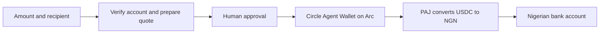

# Naira Offramp MCP

**Let AI agents pay Nigerian bank accounts from their USDC balance on Arc.**

Agents can use this MCP server to pay a business, supplier or person in NGN using funds held in Circle Agent Wallet. It verifies the recipient, prepares a payment for review, obtains human approval and tracks the payout through PAJ.

Applications provide service discovery, bookings and merchant order confirmation around these payment tools. A successful bank payment alone does not establish that a merchant delivered the goods or issued a ticket.

**Live route verified:** on October 20, 2026, Circle confirmed an Arc USDC transfer, PAJ returned a matching completed payout receipt, and the recipient confirmed receiving the NGN. See [verification evidence](docs/live-integration.md).

## How it works



Specify a recipient for each payment, or optionally save a default. The recipient can be someone else. Crypto funding addresses are handled internally.

## Quick start

Requires Node.js **22.13+**, Circle CLI **1.2.1+**, a funded Circle Agent Wallet on Arc, and a PAJ Business API key.

```sh
git clone https://github.com/Adeyemir/naira-offramp-mcp.git
cd naira-offramp-mcp
npm ci
npm run build
cp -n .env.example .env
chmod 600 .env
```

Set `PAJ_API_KEY` and `CIRCLE_ARC_ADDRESS` in your private `.env`, and authenticate through the Circle CLI. See [provider and wallet setup](docs/provider-setup.md).

Check the setup without moving funds:

```sh
npm run doctor
npm run provider:check
```

## Connect your agent

Replace `/absolute/path` with the checkout's absolute path. The MCP server uses your client's model; this project does not require an LLM API key.

### Codex

```sh
codex mcp add naira-offramp -- node --env-file="/absolute/path/naira-offramp-mcp/.env" "/absolute/path/naira-offramp-mcp/dist/cli.js"
```

### Claude Code

```sh
claude mcp add --transport stdio naira-offramp -- node --env-file="/absolute/path/naira-offramp-mcp/.env" "/absolute/path/naira-offramp-mcp/dist/cli.js"
```

Reconnect your client after registration. See the official [Codex MCP guide](https://developers.openai.com/codex/mcp) and [Claude Code MCP guide](https://code.claude.com/docs/en/mcp).

Try these requests in your private client:

> Show my USDC balance on Arc.

> Prepare a ₦5,000 payment to [bank], account [10-digit number], account holder [full name].

> Execute that prepared payment.

> Check its payout status.

Review the recipient, estimated NGN, USDC charge and gas before approving. Execution requires a human confirmation dialog using MCP form elicitation. Clients without that capability can use [local human review](docs/usage.md#local-human-review).

## Tools

| Tool               | Purpose                                                       |
| ------------------ | ------------------------------------------------------------- |
| `get_balance`      | Read the configured Arc wallet's USDC balance.                |
| `list_banks`       | Look up supported Nigerian bank names and codes.              |
| `prepare_payout`   | Verify a recipient and prepare an unfunded payment order.     |
| `execute_payout`   | Obtain human approval, recheck the order and submit once.     |
| `payout_status`    | Track the existing order and match its settlement receipt.    |
| `payout_history`   | List recent local payouts with masked account numbers.        |
| `get_default_bank` | Show the optional saved recipient.                            |
| `set_default_bank` | Verify and save a default recipient after human approval.     |
| `get_readiness`    | Check PAJ access, Arc availability and wallet authentication. |

## Payment semantics

- **NGN requests** specify an indicative receive target. PAJ applies the rate when it observes the deposit.
- **USDC requests** specify a spending budget. A configured reserve is retained for gas; the remainder funds the PAJ order.
- **Gas is estimated.** Circle's CLI does not enforce a hard network-fee cap.
- **Approval expires within five minutes.** Uncertain transfers are recorded and never automatically resent.
- **Provider completion and bank receipt are separate evidence.** PAJ status is tracked automatically; the recipient can separately confirm bank credit.

For a fixed merchant invoice, the calling application must reconcile the final NGN amount and merchant confirmation before marking the purchase paid. See [usage and recovery](docs/usage.md).

## Development

```sh
npm run format:check
npm run check
npm test
npm run build
```

Tests use controlled PAJ responses, fake Circle executables and temporary databases. They require no credentials and move no real money. The runtime contains one payment implementation: PAJ v2 with Circle Agent Wallet on Arc.

[Contributing](CONTRIBUTING.md) · [Configuration and CLI](docs/usage.md) · [Verification](docs/live-integration.md)

## License

[MIT](LICENSE).
