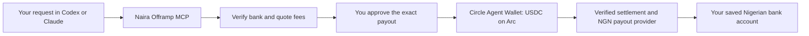

# Naira Offramp MCP

An open source MCP server for asking an agent to cash out **USDC on Arc into a Nigerian bank account**.

The wallet integration uses **Circle Agent Wallet** through the Circle CLI. A saved, verified bank account is the default payout destination, so normal cashout requests do not require a crypto address.

## Development status

This is the initial scaffold, not a working live cashout service. It includes the payout lifecycle, local persistence, amount and fee checks, a simulated provider, and Circle Agent Wallet signing glue. MCP tool registration and the live payout route are still being built.

The default mode is `demo`. Demo balances, exchange rates, and bank payouts are simulated. No real funds move.

A live Arc-to-NGN route has not been verified. The payout provider must confirm that it can receive the intended settlement before live cashouts can be enabled. Gateway moves USDC; a bank payout provider supplies the NGN rail.

## Planned flow



## Check the scaffold

Requires Node.js 22.13 or newer.

```sh
npm ci
npm run check
npm run build
```

The server, demo, and test entry points are being added next. Do not connect funds to this scaffold.

## License

MIT. Contributions are welcome; the initial scope is Arc USDC to NGN.
