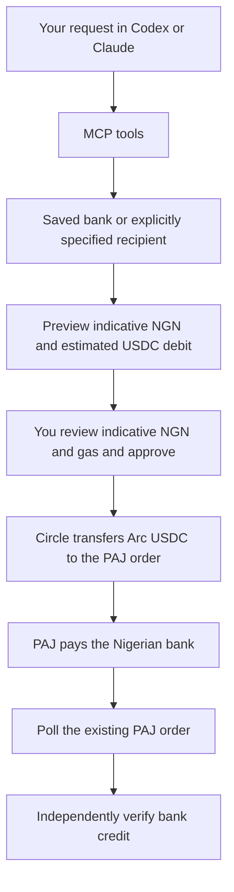

# Naira Offramp MCP

An open-source MCP integration for **USDC on Arc → NGN in a Nigerian bank account**, using **Circle Agent Wallet** and PAJ.

> **In development.** Direct Arc payout preparation and human-approved Circle transfers are implemented against PAJ v2. Live wallet reads, PAJ API access and Arc availability have been checked. A real bank payout has not yet been tested or independently verified.

The normal route sends USDC from your Circle Agent Wallet on Arc to a fresh PAJ Arc order, then tracks the NGN payout. The development simulator is an explicit opt-in.

## Set up

Requires Node.js 22.13 or newer.

```sh
git clone https://github.com/Adeyemir/naira-offramp-mcp.git
cd naira-offramp-mcp
npm ci
npm run build
cp .env.example .env
chmod 600 .env
```

Keep the default `OFFRAMP_MODE=live`. Connect your Circle Agent Wallet through the Circle CLI, save its Arc address in your private `CIRCLE_ARC_ADDRESS` configuration, and configure `PAJ_API_KEY` using [provider setup](docs/provider-setup.md). PAJ v2 uses that Business API key directly, without an email/OTP session. Normal requests use the saved wallet and bank; you do not enter a crypto destination address for cashouts.

## Connect to Codex or Claude Code

Build first. Replace `/absolute/path` below with your checkout's absolute path. These commands load your private environment file and select real account tools. Neither requires an LLM API key in this project; your MCP client supplies the model.

### Codex

```sh
codex mcp add naira-offramp --env OFFRAMP_MODE=live -- node --env-file-if-exists=/absolute/path/naira-offramp-mcp/.env /absolute/path/naira-offramp-mcp/dist/cli.js
```

### Claude Code

```sh
claude mcp add --env OFFRAMP_MODE=live --transport stdio naira-offramp -- node --env-file-if-exists=/absolute/path/naira-offramp-mcp/.env /absolute/path/naira-offramp-mcp/dist/cli.js
```

Restart or reconnect your client after registering. See the official [Codex MCP guide](https://developers.openai.com/codex/mcp) and [Claude Code MCP guide](https://code.claude.com/docs/en/mcp) for client configuration.

Start by asking:

> Show my USDC balance on Arc.

> List the Nigerian banks available through PAJ.

> Verify and save my default bank account.

Provide the bank name/code, account number and expected full holder name in your private client. PAJ resolves the account; review the resolved details in the human confirmation dialog before saving.

> Prepare an estimated NGN 1,000 payout to my saved bank from my USDC on Arc.

Review the expected NGN, USDC transfer, estimated gas, fee reserve and local approval window. The NGN amount and gas are estimates. Only then request execution and approve the human dialog.

> Show the status of that payout.

Saving a recipient and executing a payout require **MCP form elicitation** and a human approval dialog. Tool arguments cannot grant approval. Clients without forms can still prepare and inspect payouts; [local human review](docs/usage.md#local-human-review) is available.

## Cashout flow



The direct Arc order route is documented in PAJ's [current chain matrix](https://docs.paj.cash/concepts/chains). Its permanent bank-account address is Solana-only and is not used for Arc payouts. [Integration status](docs/live-integration.md) distinguishes implemented behavior from live verification.

## Tools

| Tool | Purpose |
| --- | --- |
| `get_balance` | Read actual USDC held in the configured Arc agent wallet. |
| `list_banks` | Read PAJ's Nigerian bank directory. |
| `get_default_bank` | Show the saved recipient with a masked account number. |
| `set_default_bank` | Verify the bank account and full name with PAJ, then save locally after human approval. |
| `prepare_payout` | Create a fresh PAJ Arc order and show indicative NGN and estimated gas. No transfer. |
| `execute_payout` | Obtain human approval, re-check the order, then transfer Arc USDC once. |
| `payout_status` | Poll the existing order; distinguish provider completion from verified bank credit. |
| `payout_history` | Show recent local payouts with masked account numbers. |
| `get_readiness` | Check PAJ v2 access, active Arc support, the wallet and optional Gateway balance. |

Amounts are decimal strings. NGN requests are approximate receive targets: PAJ applies the rate when the deposit is observed. A USDC request leaves a configured gas reserve in the wallet and uses the remainder as the provider payment. The reserve is not a provider fee. Estimates are checked before submission, but Circle's CLI exposes no hard network-fee cap, so the total debit is not guaranteed. The approval dialog states this explicitly.

Approval expires locally after at most five minutes; it does not lock PAJ's rate. Expired or changed order addresses cannot be funded. An uncertain transfer is persisted and never automatically resent. `provider_completed` means PAJ reports completion; `bankPaid` remains false because independent bank-credit evidence is not collected by this MCP.

## Provider integration

The PAJ client targets [the v2 API](https://docs.paj.cash/): `x-api-key` authentication, bank registration by code, rates, active chains, direct Arc offramp orders, and singular `/transaction/{id}` polling. It also implements raw onramp-order calls for Arc/Base, subject to the live active-chain flag; funding is not yet exposed as an MCP tool.

Run a read-only check:

```sh
npm run provider:check
```

Or ask your connected agent: **“Check my off-ramp integration readiness.”** This checks current provider access, live Arc availability and your Circle wallet. Gateway balance is optional diagnostics and is not required for this route. Missing API credentials are reported without trying a legacy login.

Keep API keys and Circle login codes in local setup. PAJ's v2 docs specify production; live payment preparation rejects testnet and unverified staging combinations. [Integration status](docs/live-integration.md) records the outstanding live bank test.

## Development

```sh
npm run check
npm run build
npm test
npm run doctor
```

Tests cover real account-tool wiring using controlled responses, missing-credential failures, recipient verification and approval, mode isolation, and the payout lifecycle's precision, fees, concurrency and persistence. They do not move real funds.

`npm run demo` exercises the payout lifecycle with fabricated data in an isolated temporary profile. It does not read or debit a real wallet.

`npm start` runs the stdio MCP server; it waits for an MCP client. `npm run dev` runs the TypeScript entry point. Use [usage and configuration](docs/usage.md) for more detail.

## Contributing and license

MIT. [Contributions are welcome](CONTRIBUTING.md). Initial scope: **Arc USDC → NGN**. The provider and settlement interfaces allow future integrations without changing the MCP layer.
