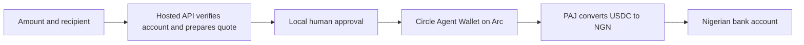

# Naira Offramp MCP

**Let AI agents pay Nigerian bank accounts from their USDC balance on Arc.**

Agents can use this MCP server to pay a business, supplier or person in NGN using funds held in Circle Agent Wallet. It verifies the recipient, prepares a payment for review, obtains human approval and tracks the payout through PAJ.

**Users do not need a PAJ account or API key.** The hosted backend manages PAJ access. Wallet authentication and USDC transfers use Circle CLI in the user's agent execution environment. Payments require human approval through a supported MCP client or the interactive CLI.

## Set up through your agent

Copy this into an agent with command execution, private file storage and network access, on your computer or in a cloud sandbox:

```text
Set up naira-offramp-mcp@0.2.2 for this AI client. Follow the
"Connect your agent" prompt at:
https://github.com/Adeyemir/naira-offramp-mcp/blob/main/docs/prompts.md

My Circle Agent Wallet is already logged in in this chat. Reuse its
existing Circle CLI and session; do not reinstall, upgrade, log out,
restart login or create a wallet. Detect my existing Arc agent wallet
and preserve existing configuration. Reuse a correct existing MCP
registration; add it only if needed and supported. Otherwise use the
documented CLI readiness checks. If MCP registration is saved but its
tools are not active, report "configured; awaiting activation" instead
of "setup complete". Report payment approval support separately.
Do not create or fund a payment.
```

Then use the [copyable prompts](docs/prompts.md) to check your balance, prepare a payment or track an existing payout. A prompt guide is included in the npm package; the repository has the current instructions. Browser-based agents can use command-enabled sandboxes when their permissions allow it. CLI access does not register native MCP tools, and payment execution needs a supported human approval flow. End-to-end payouts from ordinary web chats have not been verified.

## Project scope

Applications provide service discovery, bookings and merchant order confirmation around these payment tools. A successful bank payment alone does not establish that a merchant delivered the goods or issued a ticket.

**Live route verified:** on October 20, 2026, Circle confirmed an Arc USDC transfer, PAJ returned a matching completed payout receipt, and the recipient confirmed receiving the NGN. See [verification evidence](docs/live-integration.md).

## How it works



Specify a recipient for each payment, or optionally save a default. The recipient can be someone else. Crypto funding addresses are handled internally.

## Quick start

Requires Node.js **22.13+**, Circle CLI **1.2.1+**, and a funded Circle Agent Wallet on Arc. If Circle is already installed and authenticated in this chat's execution environment, reuse it. This package does not install Circle CLI or start a wallet login.

For a development checkout, see the [source installation](CONTRIBUTING.md#source-installation).

Create your private configuration once:

```sh
npx --yes naira-offramp-mcp@0.2.2 init
```

Edit the returned `provider.env` file, normally at `~/.local/share/naira-offramp-mcp/provider.env`. Set `CIRCLE_ARC_ADDRESS` to your existing Arc agent wallet and authenticate through the Circle CLI. The client connects to the hosted API automatically and creates its own private connection credentials. Existing configuration files are preserved. See [wallet setup](docs/provider-setup.md).

Check the setup without moving funds:

```sh
npx --yes naira-offramp-mcp@0.2.2 doctor
npx --yes naira-offramp-mcp@0.2.2 provider-check
```

## Connect your agent

Register the server once in each client that supports local stdio MCP servers. Reuse a correct existing entry and preserve other servers. Installing the npm package alone does not register its tools with your agent. The server uses your client's model; this project does not require an LLM API key.

The client launches the package when it connects and makes its tools available to the agent. It uses the local user's Circle session and private configuration. A wallet address alone does not grant spending access. The hosted service handles PAJ requests using a server secret; users receive no PAJ credentials. Their wallets fund the PAJ order directly after human approval.

### Codex

```sh
codex mcp add naira-offramp -- npx --yes naira-offramp-mcp@0.2.2
```

### Claude Code

```sh
claude mcp add --transport stdio naira-offramp -- npx --yes naira-offramp-mcp@0.2.2
```

### Antigravity

In Antigravity IDE, open the agent side panel's **… → MCP Servers → Manage MCP Servers → View raw config**. Its current global configuration is `~/.gemini/config/mcp_config.json`; workspace configuration can also live in `.agents/mcp_config.json`. Inspect the active configuration and reuse an existing entry before making changes. See [Antigravity's MCP documentation](https://antigravity.google/docs/mcp).

If missing, merge this entry into the existing `mcpServers` object:

```json
{
  "mcpServers": {
    "naira-offramp": {
      "command": "npx",
      "args": ["--yes", "naira-offramp-mcp@0.2.2"]
    }
  }
}
```

Refresh/reload the connection through the client's MCP manager if available; reconnect or restart Antigravity if activation still requires it. Reuse the existing Circle login. Choosing Opus or another model does not replace this client registration step.

### Other compatible clients

For another compatible client, set the command to `npx` and arguments to `["--yes", "naira-offramp-mcp@0.2.2"]`. Reconnect your client after registration. See the official [Codex MCP guide](https://learn.chatgpt.com/docs/extend/mcp?surface=cli) and [Claude Code MCP guide](https://code.claude.com/docs/en/mcp).

You can alternatively run `npm install --global naira-offramp-mcp@0.2.2` and register the `naira-offramp-mcp` command. Both methods run the same MCP server. Configuration and payout history stay outside the installed package, so upgrades preserve them. These examples pin a version; update it deliberately when adopting a new release.

### Verify activation

Writing configuration means **configured**, not yet **connected**. Verify that all nine tools below are available in the current client session, then call `get_readiness` through that MCP connection. While a saved registration has not loaded, report **MCP configured; awaiting activation** and any observed connection error. CLI diagnostics and a separate server test do not verify the client's active tools. Report wallet/provider blockers and payment approval support separately; a successful readiness response does not verify human approval support.

Try these requests in your private client:

> Show my USDC balance on Arc.

> Prepare a ₦5,000 payment to [bank], account [10-digit number], account holder [full name].

> Execute that prepared payment.

> Check its payout status.

Review the recipient, estimated NGN, USDC charge and gas before approving. Execution requires a human confirmation dialog using MCP form elicitation. Clients without that capability can use [local human review](docs/usage.md#local-human-review).

## Web and mobile connector preview

Development work on the web/mobile connector is separate from the published `0.2.2`
wallet integration. The source checkout includes an isolated OAuth/HTTP
compatibility test with four tools, including a browser approval test that works
without native form elicitation. It cannot connect a wallet, register a bank,
prepare an order or send funds.

See [web connector development](docs/web-connector.md) to run the test and record
observed client support. ChatGPT and Claude web/mobile payment support remains
unverified. Installing the npm package in a chat sandbox does not establish
network access, MCP registration or human approval support.

## Tools

| Tool               | Purpose                                                       |
| ------------------ | ------------------------------------------------------------- |
| `get_balance`      | Read the configured Arc wallet's USDC balance.                |
| `list_banks`       | Look up supported Nigerian bank names and codes.              |
| `prepare_payout`   | Verify a recipient and prepare an unfunded payment order.     |
| `execute_payout`   | Obtain human approval, recheck the order and submit once.     |
| `payout_status`    | Track the existing order and match its settlement receipt.    |
| `payout_history`   | List recent local payouts with masked account numbers.        |
| `get_default_bank` | Show the optional saved recipient.                            |
| `set_default_bank` | Verify and save a default recipient after human approval.     |
| `get_readiness`    | Check PAJ access, Arc availability and wallet authentication. |

## Payment semantics

- **NGN requests** specify an indicative receive target. PAJ applies the rate when it observes the deposit.
- **USDC requests** specify a spending budget. A configured reserve is retained for gas; the remainder funds the PAJ order.
- **Gas is estimated.** Circle's CLI does not enforce a hard network-fee cap.
- **Approval expires within five minutes.** Uncertain transfers are recorded and never automatically resent.
- **Provider completion and bank receipt are separate evidence.** PAJ status is tracked automatically; the recipient can separately confirm bank credit.

For a fixed merchant invoice, the calling application must reconcile the final NGN amount and merchant confirmation before marking the purchase paid. See [usage and recovery](docs/usage.md).

## Development

```sh
npm run format:check
npm run check
npm test
npm run build
npm run test:package
```

Tests use controlled PAJ responses, fake Circle executables and temporary databases. They require no credentials and move no real money. The runtime contains one payment implementation: PAJ v2 with Circle Agent Wallet on Arc.

The [Cloudflare backend](docs/backend.md) uses Workers and D1. It validates signed requests, isolates orders per installation, limits usage and records uncertain order creation without automatically retrying it. Developers can self-host the same backend with their own provider credentials.

[Copy a prompt](docs/prompts.md) · [Contributing](CONTRIBUTING.md) · [Configuration and CLI](docs/usage.md) · [Verification](docs/live-integration.md)

## License

[MIT](LICENSE).
