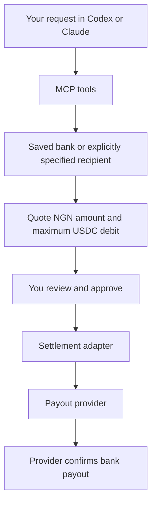

# Naira Offramp MCP

An open-source MCP integration for **USDC on Arc → NGN in a Nigerian bank account**, using **Circle Agent Wallet** and PAJ.

> **In development.** The default MCP reads your real Arc wallet balance and supports PAJ bank verification and saving a default recipient. Real cashout settlement is unfinished: payout tools are unavailable until that route is connected and verified.

The development simulator is an explicit opt-in. It is used to test the payout lifecycle while the real settlement integration is built.

## Set up

Requires Node.js 22.13 or newer.

```sh
git clone https://github.com/Adeyemir/naira-offramp-mcp.git
cd naira-offramp-mcp
npm ci
npm run build
cp .env.example .env
chmod 600 .env
```

Keep the default `OFFRAMP_MODE=live`. Connect your Circle Agent Wallet through the Circle CLI, save its Arc address in your private `CIRCLE_ARC_ADDRESS` configuration, and authenticate with your PAJ Business API credentials using [provider setup](docs/provider-setup.md). Normal requests use the saved configuration; you do not enter a wallet address for each request.

## Connect to Codex or Claude Code

Build first. Replace `/absolute/path` below with your checkout's absolute path. These commands load your private environment file and select real account tools. Neither requires an LLM API key in this project; your MCP client supplies the model.

### Codex

```sh
codex mcp add naira-offramp --env OFFRAMP_MODE=live -- node --env-file-if-exists=/absolute/path/naira-offramp-mcp/.env /absolute/path/naira-offramp-mcp/dist/cli.js
```

### Claude Code

```sh
claude mcp add --env OFFRAMP_MODE=live --transport stdio naira-offramp -- node --env-file-if-exists=/absolute/path/naira-offramp-mcp/.env /absolute/path/naira-offramp-mcp/dist/cli.js
```

Restart or reconnect your client after registering. See the official [Codex MCP guide](https://developers.openai.com/codex/mcp) and [Claude Code MCP guide](https://code.claude.com/docs/en/mcp) for client configuration.

Start by asking:

> Show my USDC balance on Arc.

> List the Nigerian banks available through PAJ.

> Verify and save my default bank account.

Provide the bank name/code, account number and expected full holder name in your private client. PAJ resolves the account; review the resolved details in the human confirmation dialog before saving.

> Check what remains before real cashouts are available.

Saving a recipient requires **MCP form elicitation** and a human approval dialog. Tool arguments cannot grant approval. Clients without forms can still inspect balances, banks and integration status; [local bank setup](docs/usage.md#local-approval-fallback) is available.

## Planned cashout flow



Wallet reads and recipient setup are connected to real APIs. Quote creation, settlement, execution and payout confirmation in this flow are still being integrated. The payout lifecycle can be exercised through the optional simulator. [Live integration status](docs/live-integration.md) records the remaining work.

## Tools

| Tool | Purpose |
| --- | --- |
| `get_balance` | Read actual USDC held in the configured Arc agent wallet. |
| `list_banks` | Read PAJ's Nigerian bank directory. |
| `get_default_bank` | Show the saved recipient with a masked account number. |
| `set_default_bank` | Verify the bank account and full name with PAJ, then save locally after human approval. |
| `get_readiness` | Check real Arc wallet/Gateway balances, provider access, Gateway support, and remaining integration blockers. |

Amounts are decimal strings. `spendableUsdc: null` means bank cashout availability is unknown while settlement is unfinished. Wallet failures return errors rather than simulated balances. Normal bank results show only the account ending; the approval dialog shows the full resolved recipient.

`prepare_payout`, `execute_payout`, `payout_status` and `payout_history` are currently exposed only in the [explicit development simulator](docs/usage.md#development-simulator). They are not available in the default server.

## Provider integration

The PAJ HTTP client implements session login, NGN bank verification, rates, off-ramp orders, and order inspection against [PAJ's official API reference](https://github.com/paj-cash/paj_ramp/blob/main/lib/API_REFERENCE.md). Bank lookup and verification are wired into the default MCP. Order creation and funding remain separate until the settlement contract is confirmed.

Run a read-only check:

```sh
npm run provider:check
```

Or ask your connected agent: **“Check my off-ramp integration readiness.”** Without provider credentials, this checks public API connectivity and reports missing authenticated access. The rate in a readiness result is indicative diagnostic data, not a payout quote. PAJ staging data is not a live market rate.

If you already have a PAJ Business API key, follow [provider setup](docs/provider-setup.md) to authenticate locally. Keep API keys, OTPs and session tokens in local setup. API access alone does not verify the settlement rail. [Live integration status](docs/live-integration.md) lists the outstanding requirements.

## Development

```sh
npm run check
npm run build
npm test
npm run doctor
```

Tests cover real account-tool wiring using controlled responses, missing-credential failures, recipient verification and approval, mode isolation, and the payout lifecycle's precision, fees, concurrency and persistence. They do not move real funds.

`npm run demo` exercises the payout lifecycle with fabricated data in an isolated temporary profile. It does not read or debit a real wallet.

`npm start` runs the stdio MCP server; it waits for an MCP client. `npm run dev` runs the TypeScript entry point. Use [usage and configuration](docs/usage.md) for more detail.

## Contributing and license

MIT. [Contributions are welcome](CONTRIBUTING.md). Initial scope: **Arc USDC → NGN**. The provider and settlement interfaces allow future integrations without changing the MCP layer.
