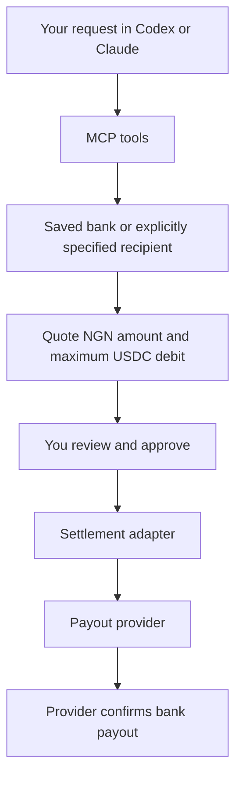

# Naira Offramp MCP

Ask an agent to cash out **USDC on Arc into a Nigerian bank account**. Save a verified bank account once; future requests use it by default.

> **Current release: a working MCP payout demo plus real wallet and provider API checks.** Payout balances, quotes, and bank payouts are simulated. Readiness checks query PAJ, Circle Agent Wallet, and Gateway. Real Arc-to-NGN settlement is not implemented or verified, and live payouts are unavailable.

The wallet integration targets **Circle Agent Wallet**, through the Circle CLI. The current demo does not access a wallet or move real funds.

## Try it

Requires Node.js 22.13 or newer.

```sh
git clone https://github.com/Adeyemir/naira-offramp-mcp.git
cd naira-offramp-mcp
npm ci
npm run build
npm run demo
```

The isolated demo saves a fake recipient, quotes NGN 15,000, simulates approval and payout, then shows the remaining balance. It creates and removes its own temporary database and needs no credentials. Demo approvals are automatic **only in this isolated script**; MCP requests use the client's confirmation dialog.

## Connect to Codex or Claude Code

Build first. Replace `/absolute/path` below with your checkout's absolute path. Neither command requires an LLM API key in this project; your MCP client supplies the model.

### Codex

```sh
codex mcp add naira-offramp --env OFFRAMP_MODE=demo -- node /absolute/path/naira-offramp-mcp/dist/cli.js
```

### Claude Code

```sh
claude mcp add --env OFFRAMP_MODE=demo --transport stdio naira-offramp -- node /absolute/path/naira-offramp-mcp/dist/cli.js
```

Restart or reconnect your client after registering. See the official [Codex MCP guide](https://developers.openai.com/codex/mcp) and [Claude Code MCP guide](https://code.claude.com/docs/en/mcp) for client configuration.

Start by asking:

> Save my demo payout account: Demo Bank, account 0000000000, holder DEMO USER.

Approve the client's confirmation dialog. Then ask:

> Quote NGN 15,000 to my saved bank from my USDC on Arc.

> Execute that demo payout.

> Show my payout status and remaining balance.

The client must support **MCP form elicitation** and display approval requests to a human. Tool arguments cannot grant approval. If your client lacks that feature, quotes and inspection still work; [local review commands](docs/usage.md#local-approval-fallback) are available.

## How it works



In this release, the settlement and provider are simulated. The Circle CLI signing helper is scaffolded for the future live integration. [Live integration status](docs/live-integration.md) explains the remaining work.

## Tools

| Tool | Purpose |
| --- | --- |
| `get_balance` | Inspect the balance available for cashouts. |
| `get_default_bank` | Show the saved recipient with a masked account number. |
| `set_default_bank` | Verify and save a recipient after human approval. |
| `prepare_payout` | Quote an exact NGN amount or a total USDC budget. |
| `execute_payout` | Obtain approval and execute the prepared payout once. |
| `payout_status` | Inspect settlement and provider progress. |
| `payout_history` | Show the ten most recent payouts. |
| `get_readiness` | Check real Arc wallet/Gateway balances, provider access, Gateway support, and remaining integration blockers. |

Amounts are decimal strings. `currency: "NGN"` means exact naira to receive; `currency: "USDC"` means maximum total USDC spend including fees. Normal tool results mask bank account numbers and omit settlement addresses. The approval dialog shows the full recipient and exact quote.

Quotes expire. Repeating execution of the same payout inspects its existing state. An uncertain submission is recorded for reconciliation and is never automatically resent. A chain confirmation alone does not mark a bank payout complete. Demo completion always returns `simulated: true` and `bankPaid: false`.

## Provider integration

The PAJ HTTP client implements session login, NGN bank verification, rates, off-ramp orders, and order inspection against [PAJ's official API reference](https://github.com/paj-cash/paj_ramp/blob/main/lib/API_REFERENCE.md). The provider client is separate from the demo payout runtime; live wallet settlement is not wired in.

Run a read-only check:

```sh
npm run provider:check
```

Or ask your connected agent: **“Check my off-ramp integration readiness.”** Without provider credentials, this checks public API connectivity and reports missing authenticated access. The rate in a readiness result is indicative diagnostic data, not a payout quote. PAJ staging data is not a live market rate.

If you already have a PAJ Business API key, follow [provider setup](docs/provider-setup.md) to authenticate locally. No real bank details, OTP, API key, or session token should be sent through chat. API access alone does not verify the settlement rail. [Live integration status](docs/live-integration.md) lists the outstanding requirements.

## Development

```sh
npm run check
npm run build
npm test
npm run doctor
```

Tests cover the MCP protocol, human approval, amount precision, fees, quote expiry, concurrent execution, uncertain submission, and persistence across server restarts. They use fake providers and do not move real funds.

`npm start` runs the stdio MCP server; it waits for an MCP client. `npm run dev` runs the TypeScript entry point. Use [usage and configuration](docs/usage.md) for more detail.

## Contributing and license

MIT. [Contributions are welcome](CONTRIBUTING.md). Initial scope: **Arc USDC → NGN**. The provider and settlement interfaces allow future integrations without changing the MCP layer.
