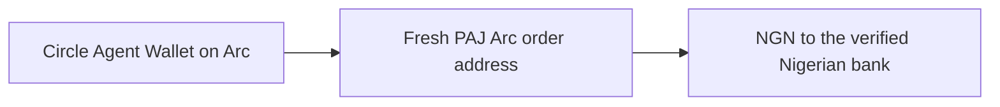

# Direct Arc integration status

**The PAJ v2 + Circle Agent Wallet direct Arc payout path has funded a reviewed live order. Circle confirmed the transfer and PAJ returned a matching completed payout receipt. Independent bank-credit verification remains outstanding.** Readiness alone does not establish delivery.

## Current provider contract

PAJ's [v2 documentation](https://docs.paj.cash/) supersedes the older GitHub API reference used by earlier commits. The [chain matrix](https://docs.paj.cash/concepts/chains) documents both onramp and offramp orders on Arc, using the USDC ERC-20 interface at `0x3600000000000000000000000000000000000000` with six decimals.

The route is:

Each order uses `bankCode` and `accountNumber`. No saved-account ID is passed. The standing address returned by bank registration is Solana-only and is not used. Gateway and intermediate settlement chains are not involved.

## Implemented

- V2 `x-api-key` authentication for rates, chain availability, banks, registration, orders and transaction polling. PAJ OTP sessions are not read.
- Full bank/account/name matching before human approval to save a default recipient.
- A fresh Arc order for each prepared payout, with immutable order details and the source wallet persisted locally.
- Circle CLI fee estimation and six-decimal USDC transfers with a stable idempotency key.
- Human approval before transfer, followed by another order, expiry, balance and estimated-fee check.
- A SQLite claim before submission; uncertain results and interrupted submissions are never automatically resent.
- Provider polling for `INIT`, `PROCESSING`, `COMPLETED` and `ERROR`, without interpreting a chain receipt as bank credit.
- Matching settled PAJ receipts to Circle's confirmed transaction hash, source, original funding destination, chain, token and amount. PAJ's final receipt can use the sender as `address` and the deposit time as `createdAt`; those fields never overwrite the original order's funding instructions.
- An explicit development simulator in separate storage.

## Amount and timing semantics

[PAJ rates](https://docs.paj.cash/concepts/rates) include the configured business fee and are indicative. The applicable rate is the one observed when the deposit arrives. NGN targets cannot be presented as guaranteed receive amounts, and a provider fee must not be added to the deposit amount twice.

For a USDC budget, the app retains `OFFRAMP_NETWORK_FEE_RESERVE_USDC` in the wallet and requests a provider order for the remainder. The reserve is not an extra fee paid to PAJ. Actual network gas is charged by Circle. The CLI estimates it but does not accept a hard fee cap; the requested total budget is therefore checked against estimates and is not guaranteed on-chain. The human approval states this limit.

[PAJ funding addresses](https://docs.paj.cash/concepts/offramp) come from a pool. Unfunded orders release their address after about two hours, and order records are deleted after 72 hours. This app permits approval for at most five minutes, bounded by the provider's address window with a margin. It re-reads the exact order immediately before transfer and refuses stale or changed details. The five-minute window is local and does not lock the FX rate.

`COMPLETED` is reported as `provider_completed`, together with PAJ's final NGN amount. `bankCreditIndependentlyVerified` and `bankPaid` remain false because this MCP has no bank-credit evidence source. `ERROR` is a failed provider outcome requiring investigation; no refund or retry is invented.

## Verification evidence

Checked 2026-10-20:

- The existing Business API key works with production v2 rates, chain and bank endpoints.
- The live chain response reports Arc active and Base inactive. Runtime availability takes precedence over a static documentation list.
- The Nigerian bank directory supplies 703 entries with usable names; nameless records are excluded.
- Circle Agent Wallet reads and an Arc transfer estimate succeed. Native USDC gas is read at 18 decimals and rounded up into the six-decimal token view, without summing the wallet's two views.
- Controlled tests exercise Arc order creation, source/destination binding, recipient approval, changing fees/orders, expiry, concurrent execution, restart after an ambiguous submission, provider errors and repriced final NGN.

On 2026-10-20, a user-approved one-off recipient was verified, a production Arc order was funded, Circle reported the transfer complete, and PAJ reported the payout completed. The final PAJ signature, sender and recipient matched the confirmed Circle transfer. This is live transfer and provider-completion evidence; independent bank credit has not yet been confirmed. Automated tests use controlled responses and move no funds.

## Funding the agent wallet

PAJ also documents [fiat onramp orders](https://docs.paj.cash/concepts/onramp) delivering USDC to a recipient on Arc. The raw client implements Arc/Base onramp requests and checks the live active-chain flag. It does not expose onramping as an MCP tool yet, and no fiat purchase has been tested. A Base route must not be assumed available while its live flag is inactive.
