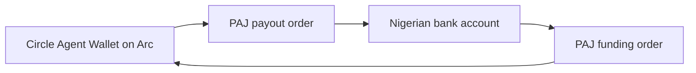

# Live integration evidence

**Both directions have completed live end-to-end tests with PAJ and an existing Circle Agent Wallet on Arc mainnet.**

| Direction | Evidence |
| --- | --- |
| USDC → naira bank payment | Circle confirmed the transfer, PAJ returned a matching completed payout receipt, and the recipient confirmed bank receipt. First confirmed on 2026-10-20. |
| Naira → agent wallet USDC | A ₦1,391.68 bank transfer produced a completed PAJ order, a 1 USDC wallet-balance increase and a successful Arc receipt crediting the expected wallet. Confirmed on 2026-10-25. |

These are individual successful tests. They do not establish an error-free service, a latency guarantee or support for other currencies, chains or browser connectors. Readiness alone does not establish delivery.

## Current provider contract

PAJ's [v2 documentation](https://docs.paj.cash/) supersedes the older GitHub API reference used by earlier commits. The [chain matrix](https://docs.paj.cash/concepts/chains) documents both onramp and offramp orders on Arc, using the USDC ERC-20 interface at `0x3600000000000000000000000000000000000000` with six decimals.

The route is:

Each payout order uses `bankCode` and `accountNumber`; funding orders specify the existing receiving wallet and return a one-time bank account for a manual transfer. No saved-account ID is passed for payouts. The standing address returned by bank registration is Solana-only and is not used. Gateway and intermediate settlement chains are not involved.

## Implemented

- V2 `x-api-key` authentication for rates, chain availability, banks, registration, orders and transaction polling. PAJ OTP sessions are not read.
- Full bank/account/name matching before human approval to save a default recipient.
- A fresh Arc order for each prepared payout, with immutable order details and the source wallet persisted locally.
- Circle CLI fee estimation and six-decimal USDC transfers with a stable idempotency key.
- Human approval before transfer, followed by another order, expiry, balance and estimated-fee check.
- A SQLite claim before submission; uncertain results and interrupted submissions are never automatically resent.
- Provider polling for `INIT`, `PROCESSING`, `COMPLETED` and `ERROR`, without interpreting a chain receipt as bank credit.
- Matching settled PAJ receipts to Circle's confirmed transaction hash, source, original funding destination, chain, token and amount. PAJ's final receipt can use the sender as `address` and the deposit time as `createdAt`; those fields never overwrite the original order's funding instructions.
- Naira funding instructions bound to the authenticated Arc agent wallet, with persisted orders, status polling and no automatic replacement after uncertain creation.
- An explicit development simulator in separate storage.

## Amount and timing semantics

[PAJ rates](https://docs.paj.cash/concepts/rates) include the configured business fee and are indicative. The applicable rate is the one observed when the deposit arrives. NGN targets cannot be presented as guaranteed receive amounts, and a provider fee must not be added to the deposit amount twice.

For a USDC budget, the app retains `OFFRAMP_NETWORK_FEE_RESERVE_USDC` in the wallet and requests a provider order for the remainder. The reserve is not an extra fee paid to PAJ. Actual network gas is charged by Circle. The CLI estimates it but does not accept a hard fee cap; the requested total budget is therefore checked against estimates and is not guaranteed on-chain. The human approval states this limit.

[PAJ funding addresses](https://docs.paj.cash/concepts/offramp) come from a pool. Unfunded orders release their address after about two hours, and order records are deleted after 72 hours. This app permits approval for at most five minutes, bounded by the provider's address window with a margin. It re-reads the exact order immediately before transfer and refuses stale or changed details. The five-minute window is local and does not lock the FX rate.

`COMPLETED` is reported as `provider_completed`, together with PAJ's final received amount. For payouts, `bankCreditIndependentlyVerified` and `bankPaid` remain false because this MCP has no bank-credit evidence source. For funding, `walletCreditIndependentlyVerified` stays false in the status response; the wallet and chain checks below were performed separately. `ERROR` is a failed provider outcome requiring investigation; no refund or retry is invented.

## Verification evidence

### Offramp: 2026-10-20

Checked 2026-10-20:

- The existing Business API key works with production v2 rates, chain and bank endpoints.
- The live chain response reports Arc active and Base inactive. Runtime availability takes precedence over a static documentation list.
- The Nigerian bank directory supplies 703 entries with usable names; nameless records are excluded.
- Circle Agent Wallet reads and an Arc transfer estimate succeed. Native USDC gas is read at 18 decimals and rounded up into the six-decimal token view, without summing the wallet's two views.
- Controlled tests exercise Arc order creation, source/destination binding, recipient approval, changing fees/orders, expiry, concurrent execution, restart after an ambiguous submission, provider errors and repriced final NGN.

On 2026-10-20, a user-approved one-off recipient was verified, a production Arc order was funded, Circle reported the transfer complete, and PAJ reported the payout completed. The final PAJ signature, sender and recipient matched the confirmed Circle transfer. The recipient subsequently confirmed receiving the fiat in their bank account. This completes the first live test with bank receipt confirmed by the recipient. No bank statement or automated bank feed was queried. Automated tests use controlled responses and move no funds.

An additional payout on 2026-10-24 also reached the recipient's bank, but its execution initially returned `PROVIDER_ORDER_CHANGED` after the Circle transfer. Polling `payout_status` reconciled the existing transfer with PAJ's completed receipt; no second transfer was sent. This is an observed reconciliation case, rather than evidence that every execution completes without an error response.

### Onramp: 2026-10-25

The local CLI prepared one funding order for the existing authenticated Circle Agent Wallet on Arc mainnet. The user transferred **₦1,391.68** from their banking app and reported sending it. The subsequent checks showed:

- PAJ reported `COMPLETED`, with **1 USDC** delivered on Arc to the expected wallet.
- The Circle CLI balance increased from **0.531872 USDC** to **1.531872 USDC**, an increase of exactly **1 USDC**.
- A separate Arc RPC check confirmed chain ID `5042`, a successful transaction receipt, and a transfer log from the USDC contract `0x3600000000000000000000000000000000000000` crediting exactly `1000000` six-decimal units to that same wallet.
- No funding or settlement error was observed in this run. No replacement order or resubmission was needed.

Transaction: [0x6572bfd3ddd6a38a5e35cbe1c2da3cb976bd93be66ca1fb69318bd0b857ba760](https://explorer.arc.io/tx/0x6572bfd3ddd6a38a5e35cbe1c2da3cb976bd93be66ca1fb69318bd0b857ba760), in block `27804161`.

The live funding test used the local `fund` and `funding-status` CLI commands. MCP tool registration and inputs were covered by automated tests. This was not a browser/mobile connector test. The bank transfer was confirmed by the user; no bank statement or bank API was queried.

#### Observed timing

All timestamps below are UTC, from the saved original order, the Arc block and the wallet check.

| Event | Timestamp |
| --- | --- |
| PAJ funding order created | 2026-10-25 13:45:23.657 |
| USDC transfer included in an Arc block | 2026-10-25 13:50:09.000 |
| First subsequent wallet check confirmed the increased balance | 2026-10-25 13:51:23.651 |

Approximately **4 minutes 45 seconds** elapsed from order creation to the on-chain credit. The first subsequent wallet check confirmed the credit approximately **6 minutes** after order creation. These intervals include manual banking time and the delay before checking again; they are not measurements of PAJ processing latency or Arc block finality.

The bank's exact send/confirmation timestamp and PAJ's bank-notification timestamp were not captured, so bank-transfer-to-wallet latency cannot be calculated from this test. There is no latency percentile, throughput result or service-level guarantee from this single run. The completed PAJ receipt's `createdAt` differed from the saved original order; the table uses the original order timestamp, not the settled receipt's timestamp.

### Runtime verification fields

Readiness checks do not run transactions or ingest this test record. Payout status does not query bank credit, and funding status alone does not independently verify wallet credit. Historical test evidence therefore does not change `livePayoutsVerified`, `liveFundingVerified`, `bankPaid`, `bankCreditIndependentlyVerified` or `walletCreditIndependentlyVerified` in automated responses. Each new payment still needs its own approval and settlement checks.

The most recent automated suite passed **84 of 84 tests** before this live funding run. Those tests use controlled wallet/provider responses and move no funds; the live evidence above is recorded separately.

## Funding the agent wallet

PAJ documents [fiat onramp orders](https://docs.paj.cash/concepts/onramp) delivering USDC to a recipient on Arc. The local funding workflow exposes `prepare_funding`, `funding_status` and `funding_history` for the configured Arc mainnet agent wallet. It returns a one-time bank account for the user to pay manually, persists uncertain creation and never automatically creates a replacement. The first live funding test is recorded above. Although the raw PAJ client includes Base requests, this test verifies only the Arc route; current active-chain availability must be checked for each request.
