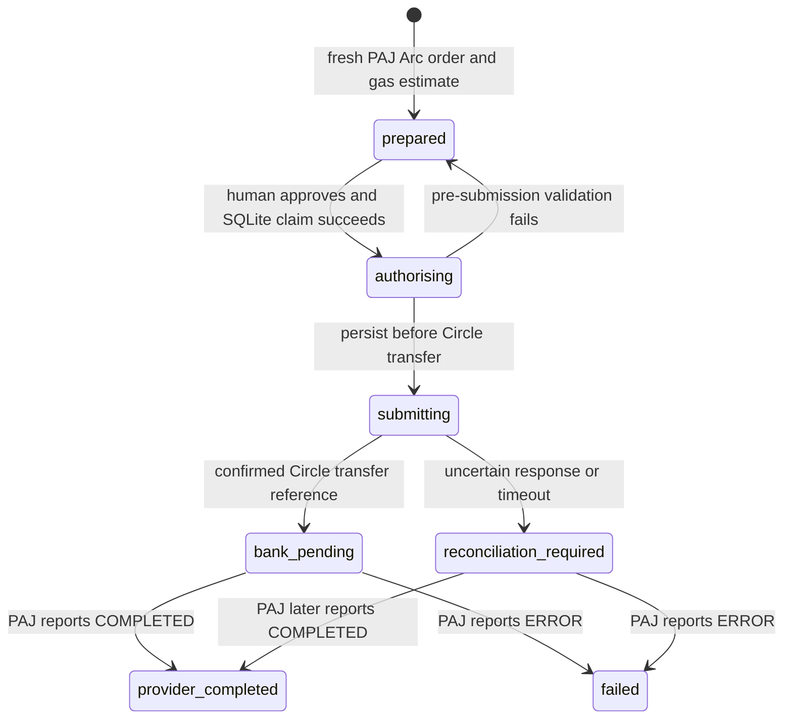

# Usage and configuration

## Configuration

`npm start` and `npm run dev` load `.env` from the current directory. A client launching Node directly should provide an absolute `--env-file-if-exists` argument or a private MCP environment.

| Variable | Default | Purpose |
| --- | --- | --- |
| `OFFRAMP_MODE` | `live` | Real Circle Agent Wallet and PAJ v2 operations. `demo` explicitly selects simulation. |
| `OFFRAMP_DATA_DIR` | `~/.local/share/naira-offramp-mcp` | Private local profile; use a separate directory for each user. |
| `OFFRAMP_MAX_USDC` | `100` | Prepared USDC budget limit, checked with estimated gas. The CLI does not guarantee a hard total-debit cap. |
| `OFFRAMP_NETWORK_FEE_RESERVE_USDC` | `0.05` | Retained for estimated Arc gas when budgeting a payout; not an additional PAJ charge. |
| `CIRCLE_BIN` | `circle` | Existing Circle CLI executable. |
| `CIRCLE_ARC_ADDRESS` | unset | Saved Circle Agent Wallet address on Arc. Normal payout requests do not supply addresses. |
| `ARC_NETWORK` | `mainnet` | Explicit Circle network. PAJ production payouts refuse `testnet`. |
| `PAJ_ENVIRONMENT` | `production` | Only production v2 is currently documented and implemented. `staging` is refused by the provider client. |
| `PAJ_API_KEY` | unset | Business API key, sent privately as `x-api-key` on every v2 request. |

`PAJ_EMAIL`, `PAJ_SESSION_TOKEN` and saved legacy OTP sessions are ignored. `npm run provider:login` is retained as an explanatory compatibility command and does not authenticate or request a code. Authenticate Circle separately with its CLI; this server does not accept Circle's Terms or manage that login.

## Real MCP tools

The live server exposes 13 tools: `get_balance`, `list_banks`, `get_default_bank`, `set_default_bank`, `get_readiness`, `prepare_payout`, `execute_payout`, `payout_status`, `payout_history`, `prepare_funding`, `funding_status`, `funding_history` and `get_receipt`. See [funding](#local-funding-tools) and [receipts](#receipts).

`get_balance` reads actual Arc USDC. `spendableUsdc: null` means the final spendable payout amount depends on an order and gas quote. Missing credentials and wallet failures produce errors without a simulated fallback.

`set_default_bank` registers and verifies the account through PAJ v2 before human confirmation of local saving. Registration can persist at PAJ even if local saving is declined. Normal results mask the account number; the approval displays the full resolved name, bank and account. The provider's returned Solana standing address is never used for Arc payouts.

`prepare_payout` opens an unfunded Arc order. Its optional `bank` input selects a one-off recipient without changing the local default; the recipient need not be the wallet owner. Omitting it uses a previously saved default. An NGN amount is an indicative target. A USDC amount budgets the payment plus estimated gas by reserving the configured amount in the wallet. Provider charges, gas estimate, reserve, requested budget and local approval expiry are shown. Neither the final NGN amount nor the total network-fee-inclusive debit is guaranteed.

`execute_payout` requires human form elicitation, revalidates the order and budget estimate, claims the payout in SQLite, persists `submitting`, then calls Circle with the payout ID as idempotency key. The CLI has no hard gas-cap flag, which is disclosed in the approval. Repeated execution never sends a second transfer.

`payout_status` polls the existing PAJ order. Provider `COMPLETED` is `provider_completed` and can report a different final NGN amount. It does not independently prove bank credit; `bankPaid` remains false. Provider `ERROR` is `failed`, with no automatic resend or refund.

PAJ's settled receipt can replace the original funding address with the sender address and change `createdAt` to the deposit time. Such a receipt is accepted only when its transaction signature, sender, recipient, chain, token and amount match the confirmed Circle transfer and original order. The original funding instructions are preserved. `providerTransferMatched` records this correlation, without claiming independent bank credit.

## Read-only checks

`npm run doctor` reports configuration presence and Circle version without printing credentials or submitting anything.

`npm run provider:check` reads v2 rates, active chains and banks, verifies that the configured address belongs to the authenticated Circle agent wallets on the selected chain, then reads its wallet and optional Arc Gateway deposit balance. A readable balance alone does not establish ownership. Gateway is not part of the direct payout route. This command does not register banks, create orders or transfer funds. The same operation is available as `get_readiness`.

`livePayoutsAvailable` reports that the configured checks passed. The runtime's `livePayoutsVerified: false` and `remainingVerification` flags are conservative: readiness checks neither run a payout nor ingest recipient confirmations. The [first live test](live-integration.md#verification-evidence) completed with a matching Circle/PAJ receipt and the recipient's confirmation of bank credit. That manual evidence is recorded separately from automated verification flags.

## Local human review

Clients without forms can prepare and inspect payouts. Complete bank setup and execution in an interactive terminal using the same profile:

```sh
npm start -- set-bank
npm start -- quote 1000 NGN
```

The quote command opens an order but sends no USDC. Read it first. Only when you intend to transfer, run:

```sh
npm start -- approve YOUR_PREPARED_PAYOUT_ID
```

Review the complete recipient and fee/rate terms, then type `APPROVE`. Piped approval is refused. There is no model-controlled approval flag.

## Live payout state



A crash during `authorising` or `submitting` leaves that state for investigation. No automatic recovery resends money. Reconcile the persisted provider order and Circle references; do not delete the database or create a replacement payout to retry. An unfunded order address must not be reused after its approval window expires.

## Local storage

Live profiles use `offramp-live-<provider-environment>-<arc-network>.sqlite`; simulation uses `offramp.sqlite`. Recipient keys include provider environment and source network. Live payout records also bind the source wallet. No simulated balance is created in a live profile.

Files are created with mode `0600` and new profile directories with mode `0700`. This is local protection, not encryption. The server serves one user/profile; it does not implement hosted multi-user authentication.

## Development simulator

```sh
npm run demo
# Or serve explicitly simulated MCP tools:
OFFRAMP_MODE=demo npm start
```

Only the simulator accepts Demo Bank / 0000000000 / DEMO USER and creates a fabricated 100 USDC ledger. `npm run demo` uses an isolated temporary profile. No real wallet is debited. Simulated ledger debits otherwise survive restarts in their separate profile.

The reusable `PayoutService` implements the simulated/generic lifecycle. Real PAJ v2 payout behavior lives in `LiveService`. Embedded applications must supply a trusted human approval callback; unconditional approval is suitable only for isolated simulation and tests.

## Local funding tools

`prepare_funding` takes `amountNgn` as positive decimal text with at most two decimals. It prepares PAJ bank instructions for the configured, authenticated Arc mainnet wallet. The person reviews and pays the exact amount from their banking app; the tool never debits fiat. `funding_status` takes the returned `fundingId`, and `funding_history` lists the latest local records with bank numbers masked.

CLI equivalents are `npm start -- fund 5000`, `npm start -- funding-status YOUR_FUNDING_ID`, and `npm start -- funding-history`. Reuse the same private environment, API key, wallet and data directory. An uncertain create request is retained and blocked from automatic retry. Existing active instructions are refreshed before reuse; expired, changed or processing instructions are not returned as payable bank details. Reconcile missing or changed provider records rather than paying again.

Once processing has been observed, a later `INIT` response cannot restore payable bank details. Versioned local updates also prevent overlapping status checks from overwriting newer progress or reconciliation results. Existing records without a version remain compatible.

Funding records are stored alongside existing payouts in a separate `funding_orders` table. The legacy data directory and OFFRAMP_* settings remain supported after the project rename. PAJ COMPLETED is reported as `provider_completed`. The live CLI/MCP then generates a receipt; `walletCreditIndependentlyVerified` becomes true only when Arc verification confirms the expected USDC credit. An unavailable or mismatched chain response leaves it false. The [first live funding test](live-integration.md#onramp-2026-10-25) records the original manual verification.

## Receipts

```sh
npm start -- receipt YOUR_LOCAL_FUNDING_OR_PAYOUT_ID
```

The MCP equivalent is `get_receipt({ "id": "YOUR_LOCAL_FUNDING_OR_PAYOUT_ID" })`. Only locally saved, PAJ-completed funding and payout orders qualify. Retrieval never creates orders, debits fiat or sends USDC. It can read Arc RPC and the existing Circle wallet balance, then writes a private local SVG and a receipt cache in the profile database.

Completed live status results contain `receipt: { data, text, svgPath }`. MCP also returns the formatted text as a separate content block. The terminal displays the receipt; redirected status output keeps the structured JSON. The `receipt` command always prints the text block and SVG path. Files use `OFFRAMP_DATA_DIR/receipts/<id>.svg`, with mode `0600` in a new `0700` directory. No fonts, images or scripts are loaded from the network by the SVG.

The generator uses recorded values, never random references or invented settlement times. Checked evidence and balance observations are cached, so the same record produces the same text, SVG bytes and path across restarts. Missing chain evidence can be checked again and upgrade the receipt to verified. Confirmation counts describe the saved check, not a continuously refreshed counter.

Arc verification checks mainnet chain ID, successful transaction, block identity, confirmations, USDC contract, amount and the expected wallet transfer. A funding receipt can verify wallet credit; a payout receipt verifies the transfer to PAJ, while bank credit stays **Not independently verified**. Balance change is an observation between two checks and can include other wallet activity or gas; it is not used as order-specific proof. Older orders without a saved baseline show **Not recorded**. Timestamps identify their source: Arc block, observed completion or original order creation.

If saving or checking a receipt fails, the completed payment remains completed and the status returns `receiptError`. Inspect the existing ID; never repeat a payment to obtain a receipt. Receipts contain financial details and the wallet address; share the SVG deliberately. Pending orders and the simulator cannot issue real payment receipts.
