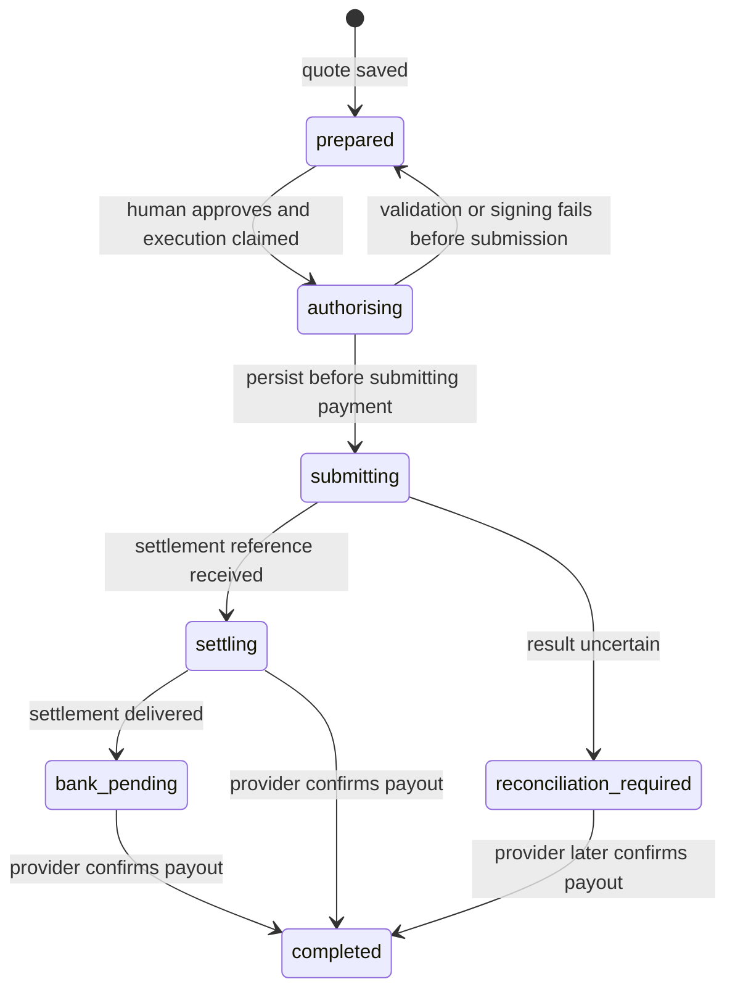

# Usage and configuration

## Configuration

Defaults require no environment file. For local overrides, copy `.env.example` to `.env`. `npm start` and `npm run dev` load that file from the current directory. A client launching `node /absolute/path/dist/cli.js` should pass variables in its MCP configuration, or pass an absolute `--env-file-if-exists` argument to Node.

| Variable | Default | Purpose |
| --- | --- | --- |
| `OFFRAMP_MODE` | `live` | Real wallet reads, PAJ bank directory, bank verification and local recipient setup. Cashout tools are unavailable until settlement is connected. `demo` explicitly enables simulated payouts. |
| `OFFRAMP_DATA_DIR` | `~/.local/share/naira-offramp-mcp` | Private local profile directory. Use different directories for different users. |
| `OFFRAMP_MAX_USDC` | `100` | Maximum total USDC debit per payout, including fees. |
| `CIRCLE_BIN` | `circle` | Circle CLI executable for wallet balance checks and the signing scaffold. |
| `CIRCLE_ARC_ADDRESS` | unset | Saved Arc agent wallet address for read-only balance checks. This does not enable live payouts. |
| `ARC_NETWORK` | `mainnet` | Source network for wallet reads, readiness checks and explicit Circle helper network selection. |
| `PAJ_ENVIRONMENT` | `production` | PAJ API environment: `staging` or `production`. This is separate from the blockchain network. |
| `PAJ_API_KEY` | unset | Business API key, used only by local provider login endpoints. |
| `PAJ_EMAIL` | unset | Email for local PAJ login; otherwise entered interactively. |
| `PAJ_SESSION_TOKEN` | unset | Optional session-token override for the selected PAJ environment. A private saved session is used otherwise. |

The server does not install or update Circle, accept its Terms, authenticate, or ask for private keys. Circle Agent Wallet signing glue uses an existing local Circle CLI session. It is not connected to demo execution.

The default server exposes `get_balance`, `list_banks`, `get_default_bank`, `set_default_bank`, and `get_readiness`. `get_balance` reads actual wallet USDC. `spendableUsdc: null` means the cashout spendable balance is unknown while settlement is unfinished. Missing credentials or wallet failures return errors; they never produce a simulated balance. `set_default_bank` resolves the full bank account and holder name with PAJ, then requests human approval to save the recipient locally. It does not call the provider's order or save-bank endpoints.

`npm run doctor` reports configuration presence and live availability without printing secrets. In demo mode it does not call Circle unless `CIRCLE_ARC_ADDRESS` is configured, in which case it checks CLI version only. It never signs or pays.

`npm run provider:check` makes read-only PAJ and Gateway API calls. It checks bank-directory access only when a session is already configured. With `CIRCLE_ARC_ADDRESS` configured, it also queries the existing Circle CLI session for the real Arc wallet's USDC balance, and Gateway for USDC deposited by that wallet on Arc. These are separate diagnostic balances; demo payout tools still use the simulated ledger. The Arc token check uses the six-decimal ERC-20 view, without adding the native balance a second time. The Gateway balance query uses a read-only POST and excludes balances on other source chains.

The check never initiates login, creates an order, or moves funds. It exits unsuccessfully when the public rate or Gateway supported-chains check fails; missing authenticated access and wallet balance errors are reported in the JSON result. A fully successful read-only check still reports `livePayoutsAvailable: false` until settlement is implemented and verified.

Provider login and private session handling are described in [provider setup](provider-setup.md). Saved PAJ session tokens are environment-specific, permission-restricted files in the private data directory; they contain no API key or OTP.

## Local approval fallback

A client without form elicitation can still inspect balances, banks and integration status. Human approval for recipient setup can happen in an interactive terminal on the same machine and with the same `OFFRAMP_DATA_DIR`:

```sh
npm start -- set-bank
npm start -- approve YOUR_PREPARED_PAYOUT_ID
```

Review the details and type `APPROVE`. Piped input is refused. `set-bank` verifies a real account with PAJ in live mode. `approve` is currently available only for explicitly simulated payouts; it cannot enable real settlement. No model-controlled approval flag is accepted.

## Development simulator

The simulator is selected explicitly:

```sh
npm run demo
# Or serve the simulated MCP tools:
OFFRAMP_MODE=demo npm start
```

It accepts only Demo Bank / 0000000000 / DEMO USER. Save that recipient, prepare a quote, approve it and inspect the simulated result to test the payout lifecycle. Only this mode exposes `prepare_payout`, `execute_payout`, `payout_status` and `payout_history`. It never moves money. Remove any old `OFFRAMP_MODE=demo` setting from your private environment or MCP configuration to use the real account tools, and reconnect your client.

## Local data

SQLite stores the verified recipient and, in simulation, quotes and payout state. Live account data uses `offramp-live-<provider-environment>-<arc-network>.sqlite`; simulated payouts use the separate `offramp.sqlite` file. Recipients are scoped to the selected environment/network. Live profiles do not create a simulated balance or transfer ledger. Files are created with mode `0600`, and a new profile directory with mode `0700`. This is local file protection, not database encryption. The MCP server serves one local user/profile; it has no hosted multi-user authentication layer.

Demo mode starts with 100 simulated USDC per profile. Simulated debits survive server restarts. `npm run demo` always uses an isolated temporary profile, so it can be repeated without changing your MCP profile.

## Payout state

This lifecycle is implemented in the payout service and exercised through the simulator. Live settlement adapters are unfinished.



A process crash during `authorising` or `submitting` leaves the recorded state for operator investigation. This release has no automatic recovery or refund command. Back up the database before investigating a real integration; do not delete payment records to retry. A fresh quote is not a safe retry for an uncertain submission.

The reusable `PayoutService` accepts an application-supplied approval callback. Embedded applications must connect that callback to their own trusted human authorization flow; an always-true callback is appropriate only for isolated simulation and tests.
