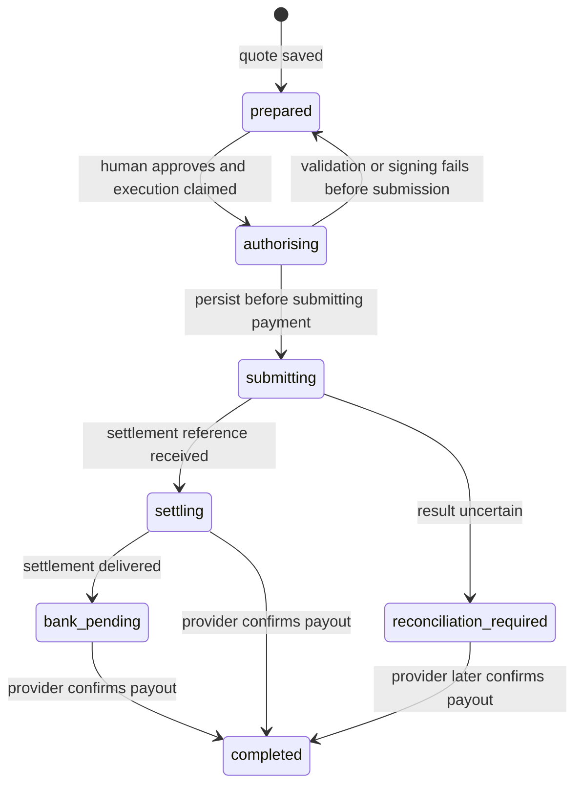

# Usage and configuration

## Configuration

Defaults require no environment file. For local overrides, copy `.env.example` to `.env`. `npm start` and `npm run dev` load that file from the current directory. A client launching `node /absolute/path/dist/cli.js` should pass variables in its MCP configuration, or pass an absolute `--env-file-if-exists` argument to Node.

| Variable | Default | Purpose |
| --- | --- | --- |
| `OFFRAMP_MODE` | `demo` | This release runs only in demo mode. `live` fails before opening a payout store. |
| `OFFRAMP_DATA_DIR` | `~/.local/share/naira-offramp-mcp` | Private local profile directory. Use different directories for different users. |
| `OFFRAMP_MAX_USDC` | `100` | Maximum total USDC debit per payout, including fees. |
| `CIRCLE_BIN` | `circle` | Circle CLI executable for the signing scaffold/version diagnostic. |
| `CIRCLE_ARC_ADDRESS` | unset | Optional address for the Circle CLI version diagnostic. This does not enable live payouts. |
| `ARC_NETWORK` | `testnet` | Source network for readiness checks and explicit Circle helper network selection. |
| `PAJ_ENVIRONMENT` | `staging` | PAJ API environment: `staging` or `production`. This is separate from the blockchain network. |
| `PAJ_API_KEY` | unset | Business API key, used only by local provider login endpoints. |
| `PAJ_EMAIL` | unset | Email for local PAJ login; otherwise entered interactively. |
| `PAJ_SESSION_TOKEN` | unset | Optional session-token override for the selected PAJ environment. A private saved session is used otherwise. |

The server does not install or update Circle, accept its Terms, authenticate, or ask for private keys. Circle Agent Wallet signing glue uses an existing local Circle CLI session. It is not connected to demo execution.

`npm run doctor` reports configuration presence and live availability without printing secrets. In demo mode it does not call Circle unless `CIRCLE_ARC_ADDRESS` is configured, in which case it checks CLI version only. It never signs or pays.

`npm run provider:check` makes read-only PAJ and Gateway API calls. It checks bank-directory access only when a session is already configured. It never initiates login, creates an order, or moves funds. It exits unsuccessfully when the public rate or Gateway check fails; missing authenticated access is reported in the JSON result. A fully successful read-only check still reports `livePayoutsAvailable: false` until settlement is implemented and verified.

Provider login and private session handling are described in [provider setup](provider-setup.md). Saved PAJ session tokens are environment-specific, permission-restricted files in the private data directory; they contain no API key or OTP.

## Local approval fallback

A client without form elicitation can still inspect balances and prepare quotes. Human approval can happen in an interactive terminal on the same machine and with the same `OFFRAMP_DATA_DIR`:

```sh
npm start -- set-bank
npm start -- approve YOUR_PREPARED_PAYOUT_ID
```

Review the details and type `APPROVE`. Piped input is refused. These are optional local review commands, and they currently work only with the fake demo bank. They do not add a model-controlled approval flag to the MCP tools.

## Local data

The SQLite database stores the recipient, quotes, provider references, and payout state. The file is created with mode `0600`, and a new profile directory with mode `0700`. This is local file protection, not database encryption. The MCP server serves one local user/profile; it has no hosted multi-user authentication layer.

Demo mode starts with 100 simulated USDC per profile. Simulated debits survive server restarts. `npm run demo` always uses an isolated temporary profile, so it can be repeated without changing your MCP profile.

## Payout state



A process crash during `authorising` or `submitting` leaves the recorded state for operator investigation. This release has no automatic recovery or refund command. Back up the database before investigating a real integration; do not delete payment records to retry. A fresh quote is not a safe retry for an uncertain submission.

The reusable `PayoutService` accepts an application-supplied approval callback. Embedded applications must connect that callback to their own trusted human authorization flow; an always-true callback is appropriate only for isolated simulation and tests.
